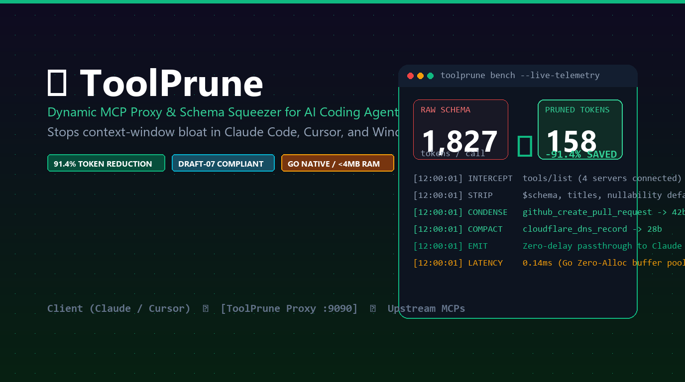
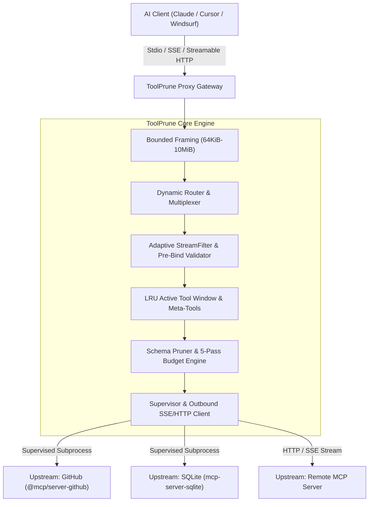

# ToolPrune

<p align="center">
  
</p>

<p align="center">
  <strong>High-utility, zero-bloat Model Context Protocol (MCP) tool router and schema compactor in Go.</strong><br>
  Compress verbose JSON schemas, enforce deterministic token budgets, dynamically route multi-server catalogs, and cut context token overhead by up to <strong>96.5%</strong> without breaking tool execution.
</p>

<p align="center">
  <a href="https://go.dev/"></a>
  <a href="https://opensource.org/licenses/MIT"></a>
  <a href="https://github.com/aloneangel45/toolprune/actions/workflows/ci.yml"></a>
  <a href="#"></a>
  <a href="#"></a>
  <a href="https://modelcontextprotocol.io"></a>
  <a href="https://github.com/aloneangel45/toolprune/releases"></a>
</p>

```text
+-----------------------------------------------------------------------------+
| $ toolprune proxy --preset balanced --max-schema-tokens 1500                |
+-----------------------------------------------------------------------------+
| [MCP Gateway]   Intercepted 6 upstream MCP servers (42 tools loaded)        |
| [Context Tax]   Raw JSON Schema payload:              46,210 tokens         |
| [AST Compactor] 5-pass token budget + active window:   1,420 tokens         |
| [Stream Filter] FNV-1a cache: 0.004ms hit | Pre-bind check: 0.011ms         |
| --------------------------------------------------------------------------- |
| Token Reduction: -96.9%   |   Cold Compaction Pass: < 0.40ms                |
| Saved / Session: 44,790 tokens/turn                                         |
+-----------------------------------------------------------------------------+
```

### One-Line Install

```bash
# macOS / Linux (SHA-256 verified)
curl -fsSL https://raw.githubusercontent.com/aloneangel45/toolprune/main/install.sh | bash

# Windows PowerShell (SHA-256 verified)
irm https://raw.githubusercontent.com/aloneangel45/toolprune/main/install.ps1 | iex
```

---

## Table of Contents

- [The Problem: The MCP Context Tax](#the-problem-the-mcp-context-tax)
- [How ToolPrune Solves It](#how-toolprune-solves-it)
- [Empirical Benchmark Results](#empirical-benchmark-results)
- [Architecture](#architecture)
  - [System Architecture](#system-architecture)
  - [Schema Pruning Pipeline](#schema-pruning-pipeline)
  - [Technical Highlights](#technical-highlights)
- [Installation](#installation)
- [Quick Start](#quick-start)
  - [1. Zero-Config Wrapper Mode](#1-zero-config-wrapper-mode)
  - [2. Deterministic Token Budget Mode (RFC #1)](#2-deterministic-token-budget-mode-rfc-1)
  - [3. Multi-Upstream Gateway Mode](#3-multi-upstream-gateway-mode)
- [Client Integration Guides](#client-integration-guides)
  - [Claude Desktop](#claude-desktop)
  - [Cursor IDE](#cursor-ide)
  - [Windsurf & Other MCP Clients](#windsurf--other-mcp-clients)
- [CLI Reference](#cli-reference)
  - [`toolprune proxy`](#toolprune-proxy)
  - [`toolprune bench`](#toolprune-bench)
  - [`toolprune routes`](#toolprune-routes)
  - [`toolprune config`](#toolprune-config)
  - [`toolprune preset`](#toolprune-preset)
  - [`toolprune version`](#toolprune-version)
- [Configuration Reference (`toolprune.yaml`)](#configuration-reference-toolpruneyaml)
- [Contributing & License](#contributing--license)

---

## The Problem: The MCP Context Tax

The **Model Context Protocol (MCP)** standardizes how frontier LLMs connect to databases, filesystems, cloud APIs, and developer tools. However, multi-server MCP deployments incur a severe structural cost: **The MCP Context Tax**.

```text
+------------------------------------------------------------------------+
|                        THE MCP CONTEXT TAX                             |
+------------------------------------------------------------------------+
| 4-6 Upstream Servers (GitHub, PostgreSQL, Cloudflare, Filesystem)      |
|                                  |                                     |
|                                  v                                     |
|                20,000 to 45,000 Schema Tokens                          |
|               Injected on EVERY SINGLE Message Turn                    |
|                                  |                                     |
|                                  v                                     |
| [COST]    Compounding API inference consumption across 30+ turn loops  |
| [LATENCY] Degraded Time-To-First-Token (TTFT) on uncached prefixes     |
| [DRIFT]   Attention dilution and parameter hallucination               |
| [BUDGET]  Context window starvation for source files and diffs         |
+------------------------------------------------------------------------+
```

1. **Redundant Schema Prose**: Typical MCP tool definitions embed multi-paragraph Markdown tutorials, decorative titles, `$schema` URIs, unreferenced `$defs`, and sprawling regular expressions.
2. **Turn Multiplication**: Full `tools/list` schemas are injected into the prompt on every turn. In a 30-turn coding session, a 25,000-token tool catalog forces 750,000 tokens of repeated schema overhead.
3. **Attention Dilution**: Oversized tool catalogs degrade instruction adherence and tool selection accuracy.

---

## How ToolPrune Solves It

**ToolPrune** is a single-binary, low-latency MCP proxy and multi-upstream router written in Go. It sits transparently between MCP clients (Claude Desktop, Claude Code, Cursor, Windsurf, Zed) and upstream servers:

- **Tier 1 (`lossless` / `--preset fast`)**: Strips `$schema` declarations, `$comment`, `examples`, decorative titles, and redundant formatting without altering parameter types or documentation semantics.
- **Tier 2 (`compact` / `--preset balanced`)**: Condenses verbose Markdown prose, strips embedded HTML/code blocks, simplifies overly long regex patterns, and truncates descriptions on word boundaries.
- **Tier 3 (`aggressive` / `--preset strict`)**: Strips redundant docstrings on self-evident parameters (`id`, `path`, `query`, `repo`, `branch`) while preserving `type`, `properties`, `required`, `enum`, `const`, `$ref`, `$defs`/`definitions`, `anyOf`/`oneOf`/`allOf`, `not`, bounds, and MCP `annotations`.
- **Tier 4 (`dynamic` / `--preset dynamic`)**: Exposes compact tool cards managed by an LRU active sliding window plus four built-in discovery/invocation meta-tools (`toolprune_search_tools`, `toolprune_get_tool_schema`, `toolprune_activate_tools`, `toolprune_invoke`). Dormant tools auto-hydrate on demand.
- **RFC #1 Adaptive Token-Budget Compactor (`--max-schema-tokens=N`)**: Enforces a hard upper bound on `tools/list` tokens in `<0.5ms` using a 5-pass structural AST compactor weighted by live `tools/call` recency and domain affinity, paired with `<0.1ms` pre-binding argument validation that returns self-correcting `CallToolResult{IsError: true}` diagnostics before invalid calls reach upstream servers.

---

## Empirical Benchmark Results

Measured using exact OpenAI `cl100k_base` BPE tokenization (`tiktoken-go`) and Go `testing.B` microbenchmarks (`AMD Ryzen 9 8945HX`, Go 1.23, `CGO_ENABLED=0`):

### 1. Realistic Enterprise MCP Suite (PostgreSQL DDL + Filesystem Diff + GitHub AST)

| Configuration | `cl100k_base` Tokens | Savings (%) | Tokens / Tool | Schema Validity |
|:---|---:|---:|---:|:---:|
| **Raw Unpruned Baseline** | 3,596 | *Baseline* | 599.3 | PASS |
| **Tier 3 (`--preset strict`)** | 2,167 | **-39.7%** | 361.2 | PASS |
| **RFC #1 (`--max-schema-tokens 350`)** | **282** | **-92.2%** | **47.0** | PASS |
| **Tier 4 (`--preset dynamic`)** | **127** | **-96.5%** | **21.2** | PASS |

### 2. Bundled Production Schema Suite (`test/fixtures/schemas.json`)

| Tier | Pruning Strategy | Tokens | Bytes | Savings (%) | Tokens / Tool | Draft-07 Status |
|:---:|:---|---:|---:|---:|---:|:---:|
| **0** | **Tier 0: Raw Unpruned** | 1,827 | 6,983 | *Baseline* | 456.8 | PASS |
| **1** | **Tier 1: Lossless Minify** | 1,761 | 6,706 | **-3.6%** | 440.2 | PASS |
| **2** | **Tier 2: Description Condensation** | 884 | 3,882 | **-51.6%** | 221.0 | PASS |
| **3** | **Tier 3: Parameter Prune** | 682 | 2,923 | **-62.7%** | 170.5 | PASS |
| **4** | **Tier 4: Dynamic Catalog** | **158** | **663** | **-91.4%** | **39.5** | PASS |

### 3. Hot-Path Stream Latency (`go test -bench=. -benchmem ./pkg/benchmark/...`)

| Operation | Latency (`ns/op`) | Wall Time | Memory (`B/op`) | Allocs |
|:---|---:|---:|---:|---:|
| `StreamFilter` Fingerprinted Cache Hit (`tools/list`) | ~3,690 ns | **0.004 ms** | 256 B | 2 |
| `StreamFilter` Pre-Binding Schema Validation (`tools/call`) | ~11,300 ns | **0.011 ms** | 4,408 B | 74 |
| `EnforceTokenBudget` 5-Pass Compactor (6 Enterprise Tools) | ~224,000 ns | **0.224 ms** | 93,208 B | 730 |
| `StreamFilter` Cold Pass + Fingerprint Registration | ~360,000 ns | **0.360 ms** | 158,000 B | 790 |

### Reproduce Benchmarks Locally

```bash
# Evaluate the bundled schema test suite
toolprune bench --file test/fixtures/schemas.json --format table

# Evaluate the realistic enterprise suite with an explicit token budget and CSV output
toolprune bench --file test/fixtures/mcp_suite_realistic.json --max-schema-tokens 350 --format csv

# Benchmark against a live upstream MCP server command
toolprune bench --verbose -- npx -y @modelcontextprotocol/server-github
```

---

## Architecture

### System Architecture

```text
                  +-----------------------------------------+
                  |   AI Client (Claude / Cursor / Windsurf)|
                  +--------------------+--------------------+
                                       |
             Inbound Transport (Stdio | SSE /sse | Streamable HTTP /mcp)
                                       |
                                       v
 +------------------------------------------------------------------------+
 |                         TOOLPRUNE CORE PROXY                           |
 |                                                                        |
 |  +------------------------------------------------------------------+  |
 |  |         Bounded Framing Reader (64 KiB init / 10 MiB cap)        |  |
 |  +----------------------------------+-------------------------------+  |
 |                                     |                                  |
 |                                     v                                  |
 |  +------------------------------------------------------------------+  |
 |  |     Dynamic Router, Multiplexer & Adaptive StreamFilter          |  |
 |  |  (Profiles, namespacing, LRU window, pre-binding call check)     |  |
 |  +----------------------------------+-------------------------------+  |
 |                                     |                                  |
 |                                     v                                  |
 |  +------------------------------------------------------------------+  |
 |  |           Schema Pruner & 5-Pass Token Budget Engine             |  |
 |  |   (Minify -> Condense -> Param Prune -> Budget -> Draft-07)      |  |
 |  +----------------------------------+-------------------------------+  |
 |                                     |                                  |
 |                                     v                                  |
 |  +------------------------------------------------------------------+  |
 |  |  Process Supervisor (Windows Job Objects / POSIX Process Groups) |  |
 |  |  & Outbound SSE / Streamable HTTP Client Transport               |  |
 |  +----------------------------------+-------------------------------+  |
 +-------------------------------------+----------------------------------+
                                       |
                 Outbound Bidirectional JSON-RPC 2.0
                                       |
                                       v
  +-----------------------+-------------------------+-------------------+
  |  Upstream Server 1    |   Upstream Server 2     | Upstream Server 3 |
  |  (GitHub MCP - stdio) |  (Postgres MCP - stdio) | (Remote MCP - SSE)|
  +-----------------------+-------------------------+-------------------+
```



### Schema Pruning Pipeline


### Technical Highlights

- **Full JSON Schema & Modern MCP Fidelity**: Preserves `$defs`, `definitions`, `$ref`, `anyOf`, `oneOf`, `allOf`, `not`, `patternProperties`, `dependentSchemas`, `dependentRequired`, `minProperties`/`maxProperties`, and MCP `title`, `outputSchema`, `annotations` (`readOnlyHint`, `destructiveHint`, `idempotentHint`, `openWorldHint`), and `icons` so Pydantic and Zod schemas never break.
- **Windows Job Object & POSIX Group Supervision**: Places upstream subprocesses inside a Windows Job Object (`JOB_OBJECT_LIMIT_KILL_ON_JOB_CLOSE`) or POSIX process group and drains `stdout`/`stderr` pipes completely prior to `Wait()`, preventing zombie leaks and pipe deadlocks.
- **Bounded Memory Framing**: Uses chunked line framing starting at `64 KiB` with a strict `10 MiB` pre-allocation ceiling, defeating unbounded line OOM attacks while keeping idle per-upstream memory minimal.
- **Localhost HTTP Hardening**: Validates `Host` and `Origin` headers on local SSE and Streamable HTTP (`/mcp`) listeners to block DNS-rebinding and cross-origin browser attacks.

---

## Installation

### 1. Automated One-Line Install (Recommended)

Downloads the platform binary release and verifies its SHA-256 digest against `checksums.txt`:

**macOS & Linux (Bash / Zsh):**
```bash
curl -fsSL https://raw.githubusercontent.com/aloneangel45/toolprune/main/install.sh | bash
```

**Windows (PowerShell):**
```powershell
irm https://raw.githubusercontent.com/aloneangel45/toolprune/main/install.ps1 | iex
```

### 2. Docker Container

```bash
docker run -i --rm ghcr.io/aloneangel45/toolprune:latest proxy --preset balanced
```

### 3. Via `go install`

Requires Go 1.23+:

```bash
go install github.com/aloneangel45/toolprune/cmd/toolprune@latest
```

### 4. Build from Source

```bash
git clone https://github.com/aloneangel45/toolprune.git
cd toolprune
go build -o toolprune ./cmd/toolprune
toolprune version
```

---

## Quick Start

### 1. Zero-Config Wrapper Mode

Prepend `toolprune proxy -- ` to any existing MCP server command without creating a config file:

```bash
# Wrap GitHub MCP server with balanced condensation
toolprune proxy --preset=balanced -- npx -y @modelcontextprotocol/server-github

# Wrap SQLite MCP server with dynamic catalog windowing (Tier 4)
toolprune proxy --preset=dynamic -- uvx mcp-server-sqlite --db-path ./test.db
```

### 2. Deterministic Token Budget Mode (RFC #1)

Cap total serialized `tools/list` schema tokens across any upstream server while getting automatic pre-binding argument self-correction:

```bash
toolprune proxy --max-schema-tokens=800 -- npx -y @modelcontextprotocol/server-github
```

### 3. Multi-Upstream Gateway Mode

Combine multiple stdio and remote HTTP/SSE MCP servers behind a single namespaced gateway:

```bash
# 1. Initialize toolprune.yaml
toolprune config init

# 2. Validate configuration syntax and upstream definitions
toolprune config validate

# 3. Inspect active routes under a security profile
toolprune routes --profile read_only

# 4. Launch over stdio or local SSE + Streamable HTTP (/sse and /mcp)
toolprune proxy --config toolprune.yaml
toolprune proxy --config toolprune.yaml --transport sse --port 8080
```

---

## Client Integration Guides

### Claude Desktop

Automatically wrap existing servers in `claude_desktop_config.json` (creates a `.bak` backup first):

```bash
# Preview changes without modifying disk
toolprune config patch-claude --dry-run

# Apply wrapper preset to Claude Desktop config
toolprune config patch-claude --preset strict
```

Or configure manually:
- **macOS**: `~/Library/Application Support/Claude/claude_desktop_config.json`
- **Windows**: `%APPDATA%\Claude\claude_desktop_config.json`
- **Linux**: `~/.config/Claude/claude_desktop_config.json`

```json
{
  "mcpServers": {
    "github": {
      "command": "toolprune",
      "args": [
        "proxy",
        "--preset=strict",
        "--max-schema-tokens=1200",
        "--",
        "npx",
        "-y",
        "@modelcontextprotocol/server-github"
      ],
      "env": {
        "GITHUB_PERSONAL_ACCESS_TOKEN": "ghp_yourTokenHere"
      }
    }
  }
}
```

### Cursor IDE

Generate `.cursor/mcp.json` directly:

```bash
toolprune preset generate --client cursor --output .cursor/mcp.json
```

Or connect Cursor to a shared local SSE / Streamable HTTP daemon:

```bash
toolprune proxy --transport=sse --port=8080 --config=toolprune.yaml
```

```json
{
  "mcpServers": {
    "toolprune_http": {
      "url": "http://127.0.0.1:8080/mcp"
    }
  }
}
```

### Windsurf & Other MCP Clients

```bash
toolprune preset generate --client windsurf --output ~/.codeium/windsurf/mcp_config.json
toolprune preset validate --client windsurf --input ~/.codeium/windsurf/mcp_config.json
```

---

## CLI Reference

### `toolprune proxy`
Starts the ToolPrune proxy in zero-config wrapper mode or multi-upstream gateway mode.

```text
Usage:
  toolprune proxy [flags] [-- <upstream_cmd> [args...]]

Flags:
  -c, --config string           Path to toolprune.yaml configuration file
  -m, --mode string             Pruning tier: none, lossless, compact, aggressive, dynamic (default "aggressive")
      --preset string           Preset alias: fast (lossless), balanced (compact), strict (aggressive), dynamic
      --max-schema-tokens int   Hard token budget for tools/list schemas (0 = disabled; env TOOLPRUNE_MAX_SCHEMA_TOKENS)
  -t, --transport string        Inbound transport protocol: stdio, sse (serves /sse, /messages, and /mcp) (default "stdio")
      --host string             Listen host address for SSE/HTTP transport (default "127.0.0.1")
  -p, --port int                Listen port for SSE/HTTP transport (default 8080)
      --profile string          Active routing profile: full, read_only, dev, minimal (default "full")
      --namespace string        Namespacing strategy: auto, always, on_collision, none (default "auto")
      --timeout duration        Request timeout duration (default 1m0s)
      --stats                   Print session token savings summary to stderr on exit (default true)
      --log-level string        Log level: debug, info, warn, error (default "info")
```

### `toolprune bench`
Evaluates exact token metrics and reduction percentages across Tiers 0-4 and optional token budgets.

```text
Usage:
  toolprune bench [flags] [-- <upstream_cmd> [args...]]

Flags:
  -f, --file string             Path to JSON schema fixtures file
      --format string           Output format: table, markdown, json, csv (default "table")
      --model string            Tokenizer engine: cl100k_base, calibrated (default "cl100k_base")
      --max-schema-tokens int   Evaluate an additional RFC #1 token budget pass
  -v, --verbose                 Display per-parameter token breakdown
```

### `toolprune routes`
Inspects upstream servers, namespaced tools, active profile rules, and filter matches.

```text
Usage:
  toolprune routes [flags]

Flags:
      --filter string    Filter upstream/tool names matching substring or regex
      --profile string   Evaluate routing table under specific profile (e.g. read_only, minimal)
      --json             Output routing table in machine-readable JSON
```

### `toolprune config`
Configuration initialization, validation, and client patching utilities.

```text
Usage:
  toolprune config [command]

Available Commands:
  init          Initialize a new toolprune.yaml configuration file with defaults
  validate      Validate toolprune.yaml syntax, schema rules, and upstream definitions
  patch-claude  Wrap existing Claude Desktop MCP servers with ToolPrune (--dry-run, --preset, --mode, --path)
```

### `toolprune preset`
Generates and validates MCP client presets for Cursor and Windsurf while preserving existing sibling keys.

```text
Usage:
  toolprune preset [command]

Available Commands:
  generate    Generate or merge a client MCP config preset for ToolPrune
  validate    Validate a client MCP config file (supports command stdio and url SSE/HTTP servers)
```

### `toolprune version`
Displays version, Git commit, build timestamp, and Go runtime details.

---

## Configuration Reference (`toolprune.yaml`)

Environment variables (`${GITHUB_TOKEN}` or `${DB_PATH:-./default.db}`) expand automatically on load.

```yaml
version: "1"

server:
  transport: "stdio" # "stdio" or "sse" (serves /sse, /messages, and Streamable HTTP /mcp)
  host: "127.0.0.1"
  port: 8080
  base_path: ""
  cors_origins: []
  timeout: "60s"
  inject_proxy_info: true

pruning:
  tier: "aggressive"          # none | lossless | compact | aggressive | dynamic
  max_schema_tokens: 0        # RFC #1 token cap (0 = disabled; env TOOLPRUNE_MAX_SCHEMA_TOKENS)
  max_description_length: 120
  max_param_desc_length: 80
  strip_regex: true
  max_regex_length: 25
  strip_self_evident: true
  strict_draft07: true
  strip_code_blocks: true
  strip_html_tags: true

routing:
  default_profile: "full"     # full | read_only | dev | minimal | custom
  namespace_mode: "auto"      # auto | always | on_collision | none
  active_window_size: 15
  auto_promote: true
  pinned_tools:
    - "toolprune_search_tools"
    - "toolprune_activate_tools"
    - "toolprune_get_tool_schema"
    - "toolprune_invoke"
  global_exclude:
    - "*_internal_*"

upstreams:
  - id: "github"
    prefix: "gh"
    transport: "stdio"
    command: "npx"
    args: ["-y", "@modelcontextprotocol/server-github"]
    env:
      GITHUB_PERSONAL_ACCESS_TOKEN: "${GITHUB_TOKEN}"

  - id: "remote_agent"
    prefix: "remote"
    transport: "sse"
    url: "http://${REMOTE_HOST:-127.0.0.1}:${REMOTE_PORT:-9000}/mcp"
    timeout: "30s"
```

---

## Contributing & License

1. Fork the repository
2. Create a feature branch (`git checkout -b feat/your-feature`)
3. Commit with Conventional Commits (`git commit -m 'feat(scope): summary'`)
4. Run static analysis, tests, and benchmarks (`go vet ./... && go test -v ./...`)
5. Open a Pull Request

Distributed under the **MIT License**. See `LICENSE` for details.
