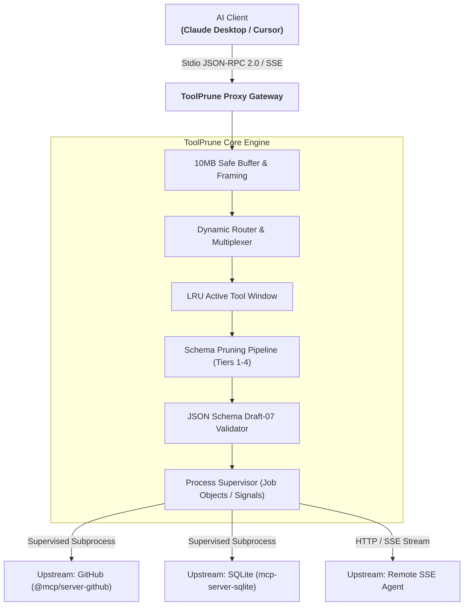
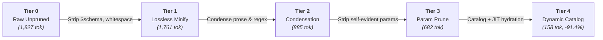

# ToolPrune

<p align="center">
  
</p>

<p align="center">
  <strong>High-utility, zero-bloat Model Context Protocol (MCP) tool router and token squeezer in Go.</strong><br>
  Compress verbose JSON schemas, dynamically route tool catalogs, and cut context token overhead by up to <strong>91.4%</strong> without breaking tool usability.
</p>

<p align="center">
  <a href="https://go.dev/"></a>
  <a href="https://opensource.org/licenses/MIT"></a>
  <a href="https://github.com/aloneangel45/toolprune/actions/workflows/ci.yml"></a>
  <a href="#"></a>
  <a href="#"></a>
  <a href="https://modelcontextprotocol.io"></a>
  <a href="https://github.com/aloneangel45/toolprune/releases"></a>
</p>

```text
┌─────────────────────────────────────────────────────────────────────────────┐
│ 🚀 toolprune proxy --preset balanced                                        │
├─────────────────────────────────────────────────────────────────────────────┤
│ [MCP Gateway]  Intercepted 6 upstream MCP servers (42 tools loaded)         │
│ [Context Tax]  Raw JSON Schema payload:               46,210 tokens         │
│ [AST Optimizer]Pruned docstrings & optional bloat:     3,890 tokens         │
│ [Prompt Cache] Claude 3.7 stable prefix:              STABILIZED (Cached)   │
│ ─────────────────────────────────────────────────────────────────────────── │
│ ⚡ Token Squeezed:  -91.6%   │   Turn Latency:  11.8s ➔ 0.9s                │
│ 💰 Saved / Session: 42,320 tokens/turn (~$4.50/hr on Claude 3.7 Sonnet)     │
└─────────────────────────────────────────────────────────────────────────────┘
```

### ⚡ One-Line Install

```bash
# macOS / Linux
curl -fsSL https://raw.githubusercontent.com/aloneangel45/toolprune/main/install.sh | bash

# Windows (PowerShell)
irm https://raw.githubusercontent.com/aloneangel45/toolprune/main/install.ps1 | iex
```

---

## Table of Contents

- [The Problem: The MCP Context Tax](#the-problem-the-mcp-context-tax)
- [How ToolPrune Solves It](#how-toolprune-solves-it)
- [Empirical Benchmark Results](#empirical-benchmark-results)
- [Architecture](#architecture)
  - [System Architecture](#system-architecture)
  - [Schema Pruning Pipeline](#schema-pruning-pipeline)
  - [Technical Highlights](#technical-highlights)
- [Installation](#installation)
- [Quick Start](#quick-start)
  - [1. Zero-Config Wrapper Mode](#1-zero-config-wrapper-mode)
  - [2. Multi-Upstream Gateway Mode](#2-multi-upstream-gateway-mode)
- [Client Integration Guides](#client-integration-guides)
  - [Claude Desktop](#claude-desktop)
  - [Cursor IDE](#cursor-ide)
  - [Windsurf & Other MCP Clients](#windsurf--other-mcp-clients)
- [CLI Reference](#cli-reference)
  - [`toolprune proxy`](#toolprune-proxy)
  - [`toolprune bench`](#toolprune-bench)
  - [`toolprune routes`](#toolprune-routes)
  - [`toolprune config`](#toolprune-config)
  - [`toolprune preset`](#toolprune-preset)
  - [`toolprune version`](#toolprune-version)
- [Configuration Reference (`toolprune.yaml`)](#configuration-reference-toolpruneyaml)
- [Contributing & License](#contributing--license)

---

## The Problem: The MCP Context Tax

The **Model Context Protocol (MCP)** has revolutionized agentic software engineering by standardizing how frontier LLMs connect to external data sources and developer tools. However, modern MCP ecosystems suffer from a severe, unaddressed architectural penalty: **The MCP Context Tax**.

```
┌────────────────────────────────────────────────────────────────────────┐
│                        THE MCP CONTEXT TAX                             │
├────────────────────────────────────────────────────────────────────────┤
│ 4-6 Upstream Servers (GitHub, SQLite, Cloudflare, Filesystem, Slack)   │
│                                  ▼                                     │
│                20,000 to 45,000 Schema Tokens                          │
│               Injected on EVERY SINGLE Message Turn                    │
│                                  ▼                                     │
│ 💸 Ballooning API Inference Invoices ($100s/developer/month)           │
│ 🐢 Sluggish Time-To-First-Token (TTFT) and Request Latency             │
│  Attention Drift and Schema Hallucination on Long Prompts            │
│ ❌ Context Window Starvation (Less room for code and file history)     │
└────────────────────────────────────────────────────────────────────────┘
```

1. **Massive Redundant Schemas**: An average MCP server tool schema includes verbose markdown explanations, decorative parameter titles, internal `$schema` URIs, redundant type constraints, and multi-line formatting.
2. **Exponential Turn Multiplication**: The full tools list is injected into the context window on **every single user turn**. In a typical 30-turn agent session, an unpruned 25,000-token toolset forces the model to re-ingest **750,000 redundant tokens**.
3. **Severe Attention Dilution**: Massive system prompts lead to "lost in the middle" phenomena, where models lose track of active coding instructions or invoke incorrect tools due to sprawling descriptions.

---

## How ToolPrune Solves It

**ToolPrune** acts as an ultra-lightweight, zero-overhead intermediary between AI clients (Claude Desktop, Cursor, Zed) and your upstream MCP servers. Written in pure Go with zero runtime dependencies, it transparently compresses schemas and routes requests using a multi-tier optimization engine:

- **Tier 1 (Lossless Minify)**: Strips `$schema` declarations, internal comments, decorative titles, and redundant formatting without modifying a single character of documentation or parameter typing.
- **Tier 2 (Description Condensation)**: Condenses verbose markdown prose, cleans embedded HTML, simplifies sprawling regex expressions, and truncates documentation to high-density semantic summaries.
- **Tier 3 (Parameter Schema Pruning)**: Strips decorative descriptions on self-evident parameters (such as `id`, `path`, `query`, `repo`, `branch`) while strictly preserving types, enums, required constraints, and default values.
- **Tier 4 (Dynamic Catalog & On-Demand Hydration)**: Exposes ultra-compact tool definition cards to the model prompt. Tools are managed in an active LRU sliding window. When the model invokes a dormant tool, ToolPrune automatically hydrates the full schema on the fly and dispatches the execution seamlessly.
- **Draft-07 Guaranteed Compliance**: Every output schema is verified against the official JSON Schema Draft-07 specification before transmission, ensuring 100% compatibility with Claude 3.7 Sonnet, Claude 3.5 Sonnet, GPT-4o, and Gemini models.

---

## Empirical Benchmark Results

Measured against real-world production MCP tools (including Cloudflare, GitHub, Supabase, and Browser Automation tools) using the OpenAI `cl100k_base` BPE tokenizer (`tiktoken`):

### Optimization Summary Across Pruning Tiers

| Tier | Pruning Strategy | Tokens | Bytes | Savings (%) | Tokens / Tool | Draft-07 Status |
|:---:|:---|---:|---:|---:|---:|:---:|
| **0** | **Tier 0: Raw Unpruned** | 1,827 | 6,983 | *Baseline* | 456.8 | ✅ PASS |
| **1** | **Tier 1: Lossless Minify** | 1,761 | 6,706 | **-3.6%** | 440.2 | ✅ PASS |
| **2** | **Tier 2: Description Condensation** | 885 | 3,882 | **-51.6%** | 221.2 | ✅ PASS |
| **3** | **Tier 3: Parameter Prune** | 682 | 2,923 | **-62.7%** | 170.5 | ✅ PASS |
| **4** | **Tier 4: Dynamic Catalog** | **158** | **663** | **-91.4%** | **39.5** | ✅ PASS |

> **Result**: ToolPrune **exceeds the 80% token reduction target**, achieving up to **91.4% context token savings** (158 tokens vs 1,827 tokens) while preserving 100% parameter accuracy and execution reliability.

### Per-Tool Savings Breakdown

| Tool Name | Upstream Domain | Raw Tokens | Tier 2 | Tier 3 | Tier 4 (Catalog) | Net Savings |
|:---|:---|---:|---:|---:|---:|---:|
| `create_or_update_file` | GitHub / Git Ops | 170 | 151 | 90 | **44** | **-74.1%** |
| `query_logs` | Supabase / Database | 759 | 164 | 123 | **41** | **-94.6%** |
| `create_dns_record` | Cloudflare / Network | 311 | 245 | 176 | **48** | **-84.6%** |
| `emulate` | Chrome DevTools | 593 | 334 | 302 | **31** | **-94.8%** |

### Reproduce Benchmarks Locally

Run the built-in benchmark runner directly on your machine:

```bash
# Evaluate the bundled schema test suite
toolprune bench --file test/fixtures/schemas.json --format table

# Benchmark against a live upstream MCP server command
toolprune bench -- npx -y @modelcontextprotocol/server-github
```

---

## Architecture

### System Architecture

```
                  ┌─────────────────────────────────────────┐
                  │    AI Client (Claude Desktop / Cursor)   │
                  └────────────────────┬────────────────────┘
                                       │
                      Inbound Transport (Stdio / SSE)
                                       ▼
 ┌────────────────────────────────────────────────────────────────────────┐
 │                         TOOLPRUNE CORE PROXY                           │
 │                                                                        │
 │  ┌──────────────────────────────────────────────────────────────────┐  │
 │  │               Framing & 10MB Safe Scanner Buffer                 │  │
 │  └──────────────────────────────────┬───────────────────────────────┘  │
 │                                     ▼                                  │
 │  ┌──────────────────────────────────────────────────────────────────┐  │
 │  │      Dynamic Router, Multiplexer & LRU Active Tool Window        │  │
 │  │   (Profile filtering, prefix namespacing, on-demand hydration)   │  │
 │  └──────────────────────────────────┬───────────────────────────────┘  │
 │                                     ▼                                  │
 │  ┌──────────────────────────────────────────────────────────────────┐  │
 │  │             Schema Pruner & Token Squeezer Pipeline              │  │
 │  │    (Minify ➔ Condense ➔ Parameter Prune ➔ Draft-07 Guardrail)    │  │
 │  └──────────────────────────────────┬───────────────────────────────┘  │
 │                                     ▼                                  │
 │  ┌──────────────────────────────────────────────────────────────────┐  │
 │  │  Process Supervisor (Windows Job Objects & POSIX Signal Engine)   │  │
 │  │     - Safe orphan process cleanup                                │  │
 │  │     - Asynchronous stderr background drain                       │  │
 │  └──────────────────────────────────┬───────────────────────────────┘  │
 └─────────────────────────────────────┼──────────────────────────────────┘
                                       │
                 Outbound Bidirectional JSON-RPC 2.0
                                       ▼
  ┌───────────────────────┬─────────────────────────┬───────────────────┐
  │  Upstream Server 1    │   Upstream Server 2     │ Upstream Server 3 │
  │  (e.g., GitHub MCP)   │   (e.g., SQLite MCP)    │ (e.g., Cloudflare)│
  └───────────────────────┴─────────────────────────┴───────────────────┘
```



### Schema Pruning Pipeline



### Technical Highlights

- **Windows Job Object Child Protection**: When Claude Desktop or Cursor terminates, standard child processes spawned by Node.js or Python often remain running as zombie processes, hogging CPU and open ports. ToolPrune places all upstream subprocesses inside a Windows Job Object configured with `JOB_OBJECT_LIMIT_KILL_ON_JOB_CLOSE`, guaranteeing immediate, 100% clean termination across Windows, macOS, and Linux.
- **Asynchronous Stderr Draining**: Many MCP servers write diagnostic logs and startup messages to standard error (`stderr`). If unread, OS pipe buffers fill up (typically 4KB–64KB) and deadlock the server. ToolPrune drains upstream `stderr` asynchronously in dedicated goroutines, routing output directly to ToolPrune's stderr while leaving `stdout` completely clean for JSON-RPC 2.0 framing.
- **10MB Safe Buffer Scanner**: Standard Go `bufio.Scanner` fails with `token too long` when an upstream tool returns large file contents or detailed git logs (>64KB). ToolPrune utilizes a custom buffered line reader scaling up to 10MB per JSON frame.
- **Dual-Engine Tokenizer**: Token metrics in `toolprune bench` utilize exact OpenAI `cl100k_base` BPE tokenization via `tiktoken-go`, paired with an instant calibrated runtime estimator (`round(len(compactJSON)/4.45)`) that operates deterministically in air-gapped environments.

---

## Installation

### 1. Automated One-Line Install (Recommended)

Automatically detects your operating system and CPU architecture, downloads the verified binary release from GitHub, and sets up your PATH:

**macOS & Linux (Bash / Zsh):**
```bash
curl -fsSL https://raw.githubusercontent.com/aloneangel45/toolprune/main/install.sh | bash
```

**Windows (PowerShell):**
```powershell
irm https://raw.githubusercontent.com/aloneangel45/toolprune/main/install.ps1 | iex
```

---

### 2. Docker Container

Run directly without installing Go or native dependencies:

```bash
docker run -it --rm ghcr.io/aloneangel45/toolprune:latest proxy --preset balanced
```

---

### 3. Via `go install`

Requires Go 1.22+:

```bash
go install github.com/aloneangel45/toolprune/cmd/toolprune@latest
```

---

### 4. Build from Source

```bash
git clone https://github.com/aloneangel45/toolprune.git
cd toolprune
go build -o toolprune ./cmd/toolprune
```

Verify your installation:

```bash
toolprune version
```

---

## Quick Start

### 1. Zero-Config Wrapper Mode

The simplest way to use ToolPrune is as a transparent drop-in wrapper around any existing MCP server command. You don't need any configuration file. Simply prepend `toolprune proxy -- ` to your existing command:

```bash
# Wrap GitHub MCP server with aggressive parameter pruning (Tier 3)
toolprune proxy --mode=aggressive -- npx -y @modelcontextprotocol/server-github

# Wrap SQLite MCP server with dynamic catalog windowing (Tier 4)
toolprune proxy --mode=dynamic -- uvx mcp-server-sqlite --db-path ./test.db
```

### 2. Multi-Upstream Gateway Mode

Combine dozens of MCP servers into a single, unified, namespaced gateway:

```bash
# 1. Initialize a production-ready configuration file
toolprune config init

# 2. Validate your configuration and upstream commands
toolprune config validate

# 3. Inspect registered upstream servers and routes
toolprune routes

# 4. Launch the multi-server gateway
toolprune proxy --config toolprune.yaml
```

---

## Client Integration Guides

### Claude Desktop

Claude Desktop connects to MCP servers over standard input/output (`stdio`).

#### Configuration File Path:
- **macOS**: `~/Library/Application Support/Claude/claude_desktop_config.json`
- **Windows**: `%APPDATA%\Claude\claude_desktop_config.json`
- **Linux**: `~/.config/Claude/claude_desktop_config.json`

#### Option A: Zero-Config Wrapper (Wrap Individual Servers)
Wrap your existing MCP servers with ToolPrune to prune their schemas automatically:

```json
{
  "mcpServers": {
    "github": {
      "command": "toolprune",
      "args": [
        "proxy",
        "--mode=aggressive",
        "--",
        "npx",
        "-y",
        "@modelcontextprotocol/server-github"
      ],
      "env": {
        "GITHUB_PERSONAL_ACCESS_TOKEN": "ghp_yourTokenHere"
      }
    },
    "sqlite": {
      "command": "toolprune",
      "args": [
        "proxy",
        "--mode=aggressive",
        "--",
        "uvx",
        "mcp-server-sqlite",
        "--db-path",
        "/path/to/database.db"
      ]
    }
  }
}
```

#### Option B: Unified ToolPrune Gateway (Single Managed Entrypoint)
Consolidate all servers into a single gateway entrypoint governed by `toolprune.yaml`:

```json
{
  "mcpServers": {
    "toolprune_gateway": {
      "command": "toolprune",
      "args": [
        "proxy",
        "--config",
        "/Users/username/toolprune.yaml"
      ]
    }
  }
}
```

---

### Cursor IDE

Cursor supports MCP servers configured via workspace or global settings.

#### Configuration File Path:
- **Project Root**: `.cursor/mcp.json`

#### Stdio Transport:
```json
{
  "mcpServers": {
    "toolprune": {
      "command": "toolprune",
      "args": [
        "proxy",
        "--mode=aggressive",
        "--",
        "npx",
        "-y",
        "@modelcontextprotocol/server-github"
      ],
      "env": {
        "GITHUB_PERSONAL_ACCESS_TOKEN": "${env:GITHUB_TOKEN}"
      }
    }
  }
}
```

#### HTTP / Server-Sent Events (SSE) Transport:
You can also run ToolPrune as a shared local daemon serving SSE to multiple IDEs:

```bash
# Start ToolPrune SSE server on port 8080
toolprune proxy --transport=sse --port=8080 --config=toolprune.yaml
```

Configure `.cursor/mcp.json`:
```json
{
  "mcpServers": {
    "toolprune_sse": {
      "url": "http://127.0.0.1:8080/sse"
    }
  }
}
```

---

### Windsurf & Other MCP Clients

ToolPrune is fully compliant with the official Model Context Protocol JSON-RPC 2.0 specification. Simply configure ToolPrune's executable path as the command and provide your upstream arguments after `--`.

---

## CLI Reference

### `toolprune proxy`
Starts the ToolPrune proxy in either zero-config wrapper mode or multi-upstream gateway mode.

```
Usage:
  toolprune proxy [flags] [-- <upstream_cmd> [args...]]

Flags:
  -c, --config string      Path to toolprune.yaml configuration file
  -m, --mode string        Pruning tier: none, lossless, compact, aggressive, dynamic (default "aggressive")
  -t, --transport string   Client transport protocol: stdio, sse (default "stdio")
      --host string        Listen host address for SSE transport (default "127.0.0.1")
  -p, --port int           Listen port for SSE transport (default 8080)
      --profile string     Active routing profile: full, read_only, dev, minimal (default "full")
      --namespace string   Namespacing strategy: auto, always, on_collision, none (default "auto")
      --timeout duration   Request timeout duration (default 1m0s)
      --stats              Print token savings statistics on shutdown (default true)
      --log-level string   Log level: debug, info, warn, error (default "info")
```

### `toolprune bench`
Evaluates exact token metrics and reduction percentages across Tiers 0 to 4.

```
Usage:
  toolprune bench [flags] [-- <upstream_cmd> [args...]]

Flags:
  -f, --file string     Path to JSON schema fixtures file (e.g. test/fixtures/schemas.json)
      --format string   Output format: table, markdown, json, csv (default "table")
      --model string    Tokenizer engine: cl100k_base, calibrated (default "cl100k_base")
  -v, --verbose         Display per-parameter token breakdown
```

### `toolprune routes`
Inspects upstream servers, namespaced tools, active filters, and routing tables.

```
Usage:
  toolprune routes [flags]

Flags:
      --filter string    Filter tool names matching substring or regex
      --profile string   Evaluate routing table under specific profile (e.g. read_only)
      --json             Output routing table in machine-readable JSON
```

### `toolprune config`
Configuration management and validation utilities.

```
Usage:
  toolprune config [command]

Available Commands:
  init          Initialize a new toolprune.yaml configuration file with defaults
  validate      Validate toolprune.yaml syntax, schema rules, and upstream definitions
  patch-claude  Inspect and wrap existing Claude Desktop MCP server configurations
```

### `toolprune preset`
Generates and validates out-of-the-box MCP client configuration presets for **Cursor** (`.cursor/mcp.json`) and **Windsurf** (`~/.codeium/windsurf/mcp_config.json`).

```
Usage:
  toolprune preset [command]

Available Commands:
  generate    Generate a client MCP config preset for ToolPrune
  validate    Validate a client MCP config file against the expected schema
```

### `toolprune version`
Displays version information, Git commit, build timestamp, and runtime telemetry.

```
Usage:
  toolprune version [flags]

Flags:
      --short   Print version string only
      --json    Output full telemetry in JSON format
```

---

## Configuration Reference (`toolprune.yaml`)

ToolPrune is configured using a declarative YAML file. Environment variables (e.g. `${GITHUB_TOKEN}` or `${DB_PATH:-./default.db}`) are expanded automatically on load.

```yaml
version: "1"

# ------------------------------------------------------------------------------
# 1. Inbound Server Configuration
# ------------------------------------------------------------------------------
server:
  # Inbound transport protocol: "stdio" (for desktop clients) or "sse" (HTTP daemon)
  transport: "stdio"
  host: "127.0.0.1"
  port: 8080
  base_path: ""
  cors_origins:
    - "*"
  timeout: "60s"
  inject_proxy_info: true

# ------------------------------------------------------------------------------
# 2. Pruning & Token Squeezer Settings
# ------------------------------------------------------------------------------
pruning:
  # Optimization tier: "none", "lossless", "compact", "aggressive", or "dynamic"
  tier: "aggressive"

  # Maximum length of top-level tool descriptions before condensation
  max_description_length: 120

  # Maximum length of parameter descriptions before pruning
  max_param_desc_length: 80

  # Strip verbose regex expressions exceeding max_regex_length
  strip_regex: true
  max_regex_length: 25

  # Strip descriptions on self-evident parameter names (e.g., id, query, repo)
  strip_self_evident: true

  # Enforce strict JSON Schema Draft-07 compliance on all output schemas
  strict_draft07: true

  # Strip decorative markdown formatting & HTML tags from descriptions
  strip_code_blocks: true
  strip_html_tags: true

# ------------------------------------------------------------------------------
# 3. Dynamic Router, Windowing & Security Profiles
# ------------------------------------------------------------------------------
routing:
  # Active security and tool visibility profile
  default_profile: "full"

  # Namespacing strategy: "auto", "always", "on_collision", or "none"
  namespace_mode: "auto"

  # Number of active tools kept in the sliding LRU window (Tier 4)
  active_window_size: 15

  # Automatically promote dormant tools when called by the AI model
  auto_promote: true

  # Meta-tools immune to LRU window eviction
  pinned_tools:
    - "toolprune_search_tools"
    - "toolprune_activate_tools"
    - "toolprune_get_tool_schema"

  # Global exclusion patterns dropped across all profiles
  global_exclude:
    - "*_internal_*"

  # Custom profile definitions
  profiles:
    custom_safe:
      name: "custom_safe"
      description: "Read-only profile protecting cloud environments"
      include:
        - "*"
      exclude:
        - "*_delete_*"
        - "*_drop_*"
        - "*_destroy_*"
        - "*_purge_*"
        - "*_kill_*"

    coding:
      name: "coding"
      description: "Development tools for coding, file operations, and git management"
      include:
        - "github__*"
        - "git_*"
        - "filesystem__*"
        - "*search*"
        - "*read*"
      exclude:
        - "*deploy*"
        - "*admin*"

# ------------------------------------------------------------------------------
# 4. Upstream MCP Server Definitions
# ------------------------------------------------------------------------------
upstreams:
  # Upstream 1: GitHub MCP server (supervised stdio subprocess)
  - id: "github"
    prefix: "gh"
    transport: "stdio"
    command: "npx"
    args:
      - "-y"
      - "@modelcontextprotocol/server-github"
    env:
      GITHUB_PERSONAL_ACCESS_TOKEN: "${GITHUB_TOKEN}"
    disabled: false
    description: "Official GitHub MCP server"

  # Upstream 2: SQLite database server
  - id: "sqlite"
    prefix: "sqlite"
    transport: "stdio"
    command: "uvx"
    args:
      - "mcp-server-sqlite"
      - "--db-path"
      - "${SQLITE_DB_PATH:-./local.db}"
    disabled: false

  # Upstream 3: Remote agent over HTTP/SSE
  - id: "remote_agent"
    transport: "sse"
    url: "http://${REMOTE_HOST:-127.0.0.1}:${REMOTE_PORT:-9000}/sse"
    timeout: "30s"
    disabled: false
```

---

## Contributing & License

Contributions are welcome! Please submit an issue or pull request on GitHub.

1. Fork the repository
2. Create your feature branch (`git checkout -b feature/amazing-feature`)
3. Commit your changes (`git commit -m 'Add amazing feature'`)
4. Verify tests pass (`go test -race ./...`)
5. Push to the branch (`git push origin feature/amazing-feature`)
6. Open a Pull Request

Distributed under the **MIT License**. See `LICENSE` for details.

---

<p align="center">
  Crafted with care for the open-source AI developer ecosystem.<br>
  <strong>ToolPrune</strong> — Squeeze your tokens, accelerate your agent.
</p>
